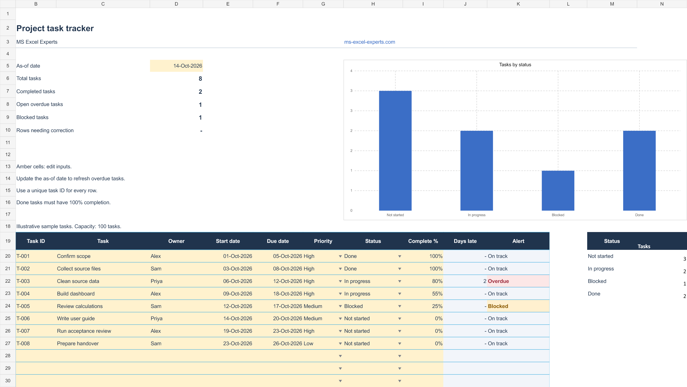

# Project Task Tracker

An Excel project tracker for assigning task owners, monitoring progress, and reviewing overdue or blocked work.

## Template preview

## Features

- **100 task rows:** organize tasks in a filterable table with unique task IDs.
- **Task ownership:** record the person responsible for each task.
- **Start and due dates:** plan deadlines and identify date conflicts.
- **Priority dropdowns:** choose High, Medium, or Low.
- **Status dropdowns:** choose Not started, In progress, Blocked, or Done.
- **Completion percentages:** record progress from 0% to 100%.
- **Days-late calculation:** review overdue open tasks against an editable as-of date.
- **Summary counts:** review total, completed, overdue, and blocked tasks.
- **Status chart:** compare task counts across the four statuses.
- **Consistency alerts:** flag missing inputs and conflicts between status and completion.

The preview uses illustrative sample tasks and an as-of date of 14 October 2026. Days late are calendar days. Update the as-of date when reviewing progress.

## Adapt the tracker to your team

You can <a href="https://ms-excel-experts.com/">hire excel experts</a> to discuss a task tracker that matches your team's reporting process.

Share your workflow with our <a href="https://ms-excel-experts.com/">spreadsheets experts</a> for help with task reporting and formulas. Explore <a href="https://ms-excel-experts.com/">Excel automation services</a> for recurring spreadsheet work.
